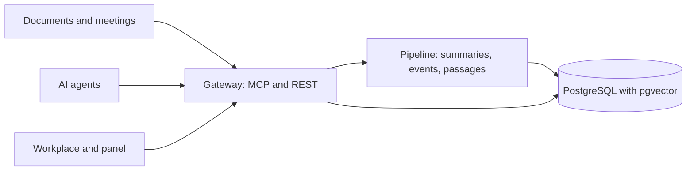

<div align="center">

<picture>
  <source media="(prefers-color-scheme: dark)" srcset="docs/assets/banner-dark.svg">
  
</picture>

**One memory for the whole company, read by every agent.**
Prisma Memory keeps what a company knows — documents, meetings, decisions — and serves it to AI agents over MCP —
each agent sees only what its person may see, and the models are the ones you choose.

[](LICENSE)
[](docs/quickstart.md)
[](docs/installation.md)
[](docs/installation.md)
[](docs/quickstart.md)

[Quick start](docs/quickstart.md) · [Installation](docs/installation.md) · [Backup and restore](docs/backup.md) · [Documentation](#documentation) · [Website](https://prismamemory.com)

</div>

---

## Why

Every employee now works with an AI agent, and every agent starts from nothing. What the company decided last
month sits in meeting notes, documents and chats that the agent cannot reach, so people paste the same context
again and again, and two agents give two answers to one question.

**Prisma Memory** is a server you run yourself. It takes in the company's documents and meeting records, turns
them into summaries, events and searchable passages, and answers agents over MCP. It applies the
person's access rights to every answer and names the source of every fact.

```text
You:    What did we decide about the supplier contract, and who owns the next step?
Agent:  (searches the memory with your rights)
        On 12 March the purchasing group chose the second offer; the legal review is with the legal team,
        due before the end of the month. Sources: meeting "Purchasing weekly", document "Offer comparison".
```

> The memory answers from what was put into it. It does not replace the systems the records came from.

## Features

<table>
<tr>
<td width="50%" valign="top">

**🔐 Rights come first**<br>
Every record lives in a space and has a data class, open or closed. An agent works with the rights of its
person and never sees more. Administrators manage access; they do not read the records.

</td>
<td width="50%" valign="top">

**🧠 Records become knowledge**<br>
A pipeline summarizes each record and extracts events and decisions with quotes from the source. Processing
runs in the background, so people and agents never wait for it.

</td>
</tr>
<tr>
<td valign="top">

**🔎 Search that says how it searched**<br>
Keyword search works from the first minute. Connect an embedding model and search also finds by meaning;
a reranker is optional. Every answer says which parts were used.

</td>
<td valign="top">

**🤖 MCP for agents**<br>
Agents connect to one MCP server over Streamable HTTP with a personal key or a browser sign-in. On a default
installation the gateway's published port answers only what agents use: MCP, the sign-in of agents, the agent skill,
signed links to original files, uploads with an upload ticket and a status-only health check; the second published
port serves the panel and the workplace. With the profile `internal-http` the REST API for other systems also
answers callers on the internal networks.

</td>
</tr>
<tr>
<td valign="top">

**🖥 Workplace and panel**<br>
Employees get a web workplace for their spaces and records. Administrators get a panel for settings, people,
keys, the audit log and the health of the installation.

</td>
<td valign="top">

**📄 Documents and meetings**<br>
Upload documents and meeting transcripts in the workplace. Each one keeps its original, its versions and its
place in a space. PDF needs an external converter (`integrations.converter_url`); Markdown and text work out
of the box.

</td>
</tr>
<tr>
<td valign="top">

**🔑 Sign-in you control**<br>
The first administrator signs in with a one-time install code. People sign in through your directory, LDAP
or OpenID Connect, or with an e-mail and a password on an account made in the panel. Agents use personal keys that
an administrator can revoke.

</td>
<td valign="top">

**🧩 Your models, your rules**<br>
Use any OpenAI-compatible endpoint, the Anthropic or the Gemini API, or a server of your own. A data policy
lists which endpoint may receive open records and which may receive closed ones.

</td>
</tr>
</table>

Also: an audit log, money budgets for model calls, a switch to another embedding model without
downtime, and a hardened Docker Compose install. External access from the internet is a preview.

## What you need

| What | Why |
| --- | --- |
| A Linux server with Docker | Rootful Docker, not rootless; the account that runs the installer is in the group `docker`. The installer builds the images there and starts the stack |
| A chat model | It writes the summaries and extracts the events; without it records are stored and searched by keyword |
| An embedding model | It adds search by meaning; without it search works by keyword |
| A directory, LDAP or OpenID Connect | Optional: people sign in through it; without one, the panel makes accounts with an e-mail and a password. The first administrator needs none |

Record text goes only to the model endpoints you list in the data policy and, for documents, to the converter you
set, and nowhere else. An online install (`deploy/compose/setup`) downloads the base images of Node.js and of
PostgreSQL with pgvector and the image of the storage server from Docker Hub, and pnpm (through Corepack) and the
npm packages of `pnpm-lock.yaml` from the npm registry. An install from an offline kit
(`deploy/compose/setup --offline KIT`) downloads nothing; the kit is one you make yourself, on a machine with access
to those registries, with `tools/release/offline-kit.sh`. Preparing the server with `deploy/host/prepare-host.sh` is
a separate step: it installs system packages from the server's package sources and, when Docker is missing, Docker
from Docker's own repository. Requirements: [Installation](docs/installation.md#requirements).

## How it works



1. **Take in.** A document or a meeting arrives through the workplace or the API and is stored in its space.
2. **Process.** The pipeline writes a summary, extracts events and prepares passages for search.
3. **Answer.** An agent asks over MCP; the gateway searches with the person's rights and returns sources.

## Quick start

You need a server with Ubuntu 22.04, 24.04 or 26.04, or Debian 12 or 13, and Docker; models can be connected later
([Installation](docs/installation.md#models)). Run every step on the server, as the account that will own the
installation; only the tunnel of step 3 runs on your own computer.

1. **Get the code and check the server.** The check changes nothing.

   ```bash
   git clone https://github.com/Scientetiq/prisma-memory.git && cd prisma-memory
   bash deploy/host/prepare-host.sh --check
   ```

   It ends with exit code 0 when everything is in place and 1 when something is still to do. The lines marked
   `TODO`, `UNKNOWN` or `FAIL` name what, and [server preparation](docs/installation.md#prepare-the-server) says
   how to do it. Run as an account other than root, the check marks the items that need root `UNKNOWN`, so it ends
   with 1; run it with `sudo` to see them too. On a system that is not supported, it ends with exit code 69 and
   says `unsupported system`.

2. **Install.** `setup` asks no questions. It builds the images on the server and starts the stack; the first
   build of the images takes most of the time.

   ```bash
   deploy/compose/setup
   ```

   When it worked, it ends with exit code 0 and a summary. With the default ports, the panel is at
   `http://127.0.0.1:8081` and the agents' address is `http://127.0.0.1:8080/mcp`. The `Tunnel:` line gives the SSH
   command for the panel, and the `Install code:` line names the file with the install code for the first
   administrator. Exit code 3 means that a check refused: the line that starts with `setup: refused:` names the
   reason; fix it and run `setup` again. Exit code 1 means that it stopped in the middle: run it again, and it
   continues.

3. **Create the first administrator.** On your own computer, run the command of the `Tunnel:` line, then open
   `http://127.0.0.1:8081/admin/first-run`; the address `http://127.0.0.1:8081` alone opens the sign-in page of the
   workplace. On the server, read the install code with the command of the `Install code:` line.
   Enter the code, a login and a password of at least 12 characters. The page then shows the system key of the
   installation once: keep it in a password manager.

Next: [server preparation, models and the first sign-in](docs/installation.md), then the
[quick start](docs/quickstart.md) from step 4 up to the first answer of an agent. When a step fails, see
[troubleshooting](docs/troubleshooting.md) and the table at the end of
[installation](docs/installation.md#if-something-goes-wrong).

An installation runs only with the copy of the repository it was installed from. To move it to a new release, check
out the new tag in the same folder and run `deploy/compose/setup upgrade`: it copies the database first and rolls back
when the new version fails ([upgrade](docs/installation.md#upgrade-and-backup)). Backup and restore work at the same
version: [backup and restore](docs/backup.md).

## Connect an agent

The shortest way is a personal key from the workplace. For Claude Code, run this command on the server. To run it on
your own computer, first open a second tunnel: the command of the `Tunnel:` line with `8080` in place of each `8081`
(the default ports):

```bash
claude mcp add --transport http --scope user prisma-memory http://localhost:8080/mcp --header "Authorization: Bearer <personal key mem_p_…>"
```

The [quick start](docs/quickstart.md) shows the first connection step by step. A meeting that an agent uploads
is closed until a person opens it in the workplace; until then no agent finds it, not even the agent that
uploaded it.

## Documentation

| Section | What it covers |
| --- | --- |
| [Quick start](docs/quickstart.md) | one server, from download to the first answer of an agent |
| [Installation](docs/installation.md) | requirements, server preparation, setup, models, first sign-in |
| [Backup and restore](docs/backup.md) | a cold copy of an installation and how to bring it back |
| [Configuration](docs/configuration.md) | where settings live and how they are read |
| [Models](docs/models.md) | connecting models, recommended models, changing the embedding model |
| [Troubleshooting](docs/troubleshooting.md) | symptoms, where to look, what to do |
| [Glossary](docs/glossary.md) | the terms of the product |
| [Security](SECURITY.md) | reporting a vulnerability, scope |

## Repository layout

```text
contracts/   the source of truth: database schema, MCP tools, REST API, prompts
packages/    gateway (MCP + REST) · workers (pipeline) · admin (web interface) · shared code
deploy/      host preparation · the Docker Compose install
tools/       administration, service-key, licence-list and offline-kit tools
docs/        documentation
```

## Contributing and security

Report a problem or suggest an idea in the issue tracker of the repository, with the bug report or the feature
request form. Pull requests that change the code are not reviewed and are closed, as
[CONTRIBUTING.md](CONTRIBUTING.md) explains. Report a vulnerability privately as described in
[SECURITY.md](SECURITY.md).

## License

Prisma Memory is distributed under the **Prisma Memory License 1.0** (see the `LICENSE` file). It is source-available software, not open source. It is free of charge for groups with fewer than 100 people and less than USD 10 million in annual revenue for their internal purposes, and for individuals for personal, educational and research purposes. Other uses require a commercial licence: https://prismamemory.com/.

Parts of this repository are under the Apache License 2.0, and third-party components keep their own licences:
see `NOTICE` and `third_party_licenses/`.
